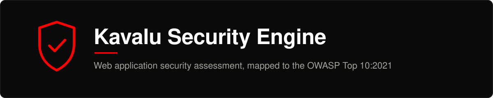

<div align="center">



<br>

[](https://github.com/vinayakanw/vnw_kavalu_security_engine/actions/workflows/ci.yml)
[](LICENSE)
[](requirements.txt)
[](docs/checks.md#owasp-top-102021-coverage)
[](CONTRIBUTING.md)

**Automated web application security assessment with explainable scoring and OWASP Top 10:2021 mapping.**

[Quick start](#quick-start) ·
[Documentation](#documentation) ·
[API](docs/api.md) ·
[Contributing](CONTRIBUTING.md) ·
[Security](SECURITY.md) ·
[Official portal](https://kavalu-labs.nayaka100.in/)

</div>

> [!IMPORTANT]
> **Authorised use only.** This engine sends active payloads (SQL injection, XSS, command injection, path traversal) and submits forms.
> Run it **only** against systems you own or have explicit written permission to test. Unauthorised scanning may be illegal and can damage the target.
> See [SECURITY.md](SECURITY.md#responsible-use).

---

## Contents

- [Overview](#overview)
- [Quick start](#quick-start)
- [Scan modules](#scan-modules)
- [OWASP Top 10:2021 coverage](#owasp-top-102021-coverage)
- [Risk scoring](#risk-scoring)
- [API at a glance](#api-at-a-glance)
- [Project layout](#project-layout)
- [Configuration](#configuration)
- [Development](#development)
- [Known limitations](#known-limitations)
- [Documentation](#documentation)
- [Community](#community)
- [License](#license)
- [Author](#author)

## Overview

Kavalu Security Engine checks **one web page** for common security problems. You choose which checks to run.
It reports each problem with its **OWASP Top 10:2021** category and **CWE** number, gives the page a **score from 0 to 100**
with a letter grade, and writes a report (PDF, HTML or JSON).

- **Easy to explain.** Every finding comes from a readable rule, and the score comes from a published formula. There is no black box.
- **Simple to run.** One Flask app serves both the dashboard and the API. There is no database, queue or build step.
- **Live progress.** The dashboard follows a scan while it runs.
- **Private.** The server keeps no scan history. The dashboard saves history in your own browser.
- **Honest about its limits.** What is and is not checked is written down in [docs/checks.md](docs/checks.md#known-blind-spots).

<details>
<summary><b>Sample report</b> (generated from the built-in practice target)</summary>

<br>

A real PDF produced by this engine against the deliberately vulnerable local target in `tests/`:
[**docs/assets/sample-report.pdf**](docs/assets/sample-report.pdf). It contains the executive summary, the OWASP coverage matrix,
target attribution, findings with evidence and remediation, and a prioritised remediation roadmap.

</details>

## Quick start

**Requirements:** Python 3.10+ and Git. Docker is optional; Chromium is needed only for the browser module (the Docker image includes it).

### Run locally

```bash
git clone https://github.com/vinayakanw/vnw_kavalu_security_engine.git
cd vnw_kavalu_security_engine

python3 -m venv .venv
source .venv/bin/activate            # Windows: .venv\Scripts\activate
pip install -r requirements.txt

flask --app app run --host 127.0.0.1 --port 5000
```

Open **<http://127.0.0.1:5000>**.

> Use the command above (or `make run`) instead of `python app.py`: the latter listens on **all network interfaces**, which would expose an unauthenticated scanner to your network.

### Run with Docker

```bash
docker build -t kavalu-security-engine .
docker run --rm -p 127.0.0.1:5000:10000 kavalu-security-engine
```

The image includes headless Chromium, so the browser module works. See [docs/deployment.md](docs/deployment.md) for volumes, Render and production settings.

### Run your first scan, safely

Do not practise on a website you do not own. The repository ships a deliberately vulnerable local target:

```bash
# terminal 1: the engine
make run

# terminal 2: the practice target (listens on 127.0.0.1 only)
make demo-target
#   Paste this into the dashboard:  http://127.0.0.1:35907/?id=1
```

Paste the printed URL into the dashboard and start a scan. Against the practice target you should see roughly:
1 critical (SQL injection), 2 high, 7 medium, 3 low findings and a score of **100 / grade F**.

Prefer the API? See [docs/api.md](docs/api.md#quick-end-to-end-example).

## Scan modules

Choose any combination per scan with `scan_types` (default `["all"]`).

| Module | `scan_types` | What it does |
|---|---|---|
| Reconnaissance | `recon` | Hosting, IP, ASN and geolocation; public developer attribution; six security-header checks |
| Injection probes | `owasp` | Reflected XSS, SQL injection, command injection, path traversal, open redirect, host-header injection, CSRF, SSRF-candidate parameters |
| TLS | `tls` | HTTPS presence, negotiated protocol version, certificate validity and expiry |
| Misconfiguration | `misconfig` | Exposed sensitive files, CORS, risky HTTP methods, cookie flags, debug output, outdated JavaScript libraries, Subresource Integrity |
| Browser | `browser` | Headless Chromium: DOM XSS, mixed content, insecure forms, client storage. Needs Chromium and `use_selenium: true` |
| Burp Suite | `burp` | Routes probe traffic through a Burp proxy at `127.0.0.1:8080`. Needs `use_burp: true` |

Details, severities and the exact list of finding types: [docs/checks.md](docs/checks.md).

> **Give the scanner something to test.** It examines the single page you supply and does not crawl.
> Parameter-based probes use the query parameters already in the URL and the forms on that page:
> scan `https://site.example/search?q=test`, not just `https://site.example/`.

## OWASP Top 10:2021 coverage

| | Category | Automated checks |
|:-:|---|---|
| A01 | Broken Access Control | Yes |
| A02 | Cryptographic Failures | Yes |
| A03 | Injection | Yes |
| A04 | Insecure Design | None |
| A05 | Security Misconfiguration | Yes |
| A06 | Vulnerable and Outdated Components | Narrow: five JavaScript libraries only |
| A07 | Identification and Authentication Failures | None |
| A08 | Software and Data Integrity Failures | Narrow: Subresource Integrity only |
| A09 | Security Logging and Monitoring Failures | None |
| A10 | Server-Side Request Forgery | Heuristic only: flags parameter names, never attempts SSRF |

A clean scan means *"none of these checks found anything"*, not *"secure"*. Per-category detail: [docs/checks.md](docs/checks.md#owasp-top-102021-coverage).

## Risk scoring

Deterministic and reproducible from the finding list:

```text
score = min(100, Σ weight(severity) × 0.6^n)      n = findings of that severity already counted
```

| Severity | Weight | | Score | Grade | Label |
|---|---:|---|---:|:---:|---|
| critical | 40 | | 0 – < 20 | **A** | Low Risk |
| high | 22 | | 20 – < 40 | **B** | Moderate Risk |
| medium | 10 | | 40 – < 60 | **C** | Elevated Risk |
| low | 4 | | 60 – < 80 | **D** | High Risk |
| info | 0 | | 80 – 100 | **F** | Critical Risk |

Each additional finding of the same severity counts for 60% of the previous one, so a long tail of minor issues cannot outweigh a critical one.
Derivation and edge cases: [docs/architecture.md](docs/architecture.md#scoring).

## API at a glance

| Method | Path | Purpose |
|---|---|---|
| `POST` | `/api/scan` | Start a scan: `{"url": "…", "scan_types": ["owasp", "tls"]}` |
| `GET` | `/api/scan/status/<scan_id>` | Progress, findings, risk score, OWASP coverage |
| `GET` | `/api/scan/stream/<scan_id>` | Live progress (Server-Sent Events) |
| `GET` | `/api/report/<scan_id>?format=pdf\|html\|json` | Download a report (default `pdf`) |
| `GET` | `/api/owasp-top10` | OWASP Top 10:2021 reference data |
| `GET` | `/api/history` | Always `[]`; also the health check |

Full reference with request/response examples, error codes and SSE events: [docs/api.md](docs/api.md).

## Project layout

```text
.
├── app.py                     Flask app: routes, CORS, SSE
├── index.html                 Dashboard page
├── static/                    Dashboard script, stylesheet and icon
├── core/
│   ├── scanner.py             Orchestrator, target validation, security headers, persistence
│   ├── vulnerability_scanner.py   Injection probes and misconfiguration checks
│   ├── tls_scanner.py         TLS handshake, protocol, certificate checks
│   ├── recon_attribution.py   Hosting and developer attribution
│   ├── selenium_scanner.py    Headless-browser checks (optional)
│   ├── burp_integration.py    Burp Suite proxy routing (optional)
│   ├── plugin_model.py        Optional external ML model hook
│   ├── detection_engine.py    Risk score and grade
│   ├── owasp_mapping.py       Finding type → OWASP category and CWE
│   ├── report_generator.py    PDF / HTML / JSON reports
│   └── paths.py               Where files are written
├── tests/                     Offline test suite and a deliberately vulnerable local target
├── docs/                      Architecture, API, configuration, checks, deployment, …
├── scripts/                   check_dco.py, generate_sample_report.py
├── .github/                   CI workflows, issue forms, PR template, Dependabot
├── Dockerfile · render.yaml   Container image and Render blueprint
└── Makefile · pyproject.toml  Developer commands and tool configuration
```

## Configuration

Everything is optional. Key variables (full list in [docs/configuration.md](docs/configuration.md)):

| Variable | Purpose |
|---|---|
| `KAVALU_DATA_DIR` | Where `reports/` and `logs/` are written (use a persistent volume in production) |
| `PORT` | Port for `python app.py` (default 5000) |
| `SECRET_KEY` | Flask signing key (random per start if unset) |
| `EXTERNAL_MODEL_URL` | Enables the optional external ML model plugin |

Copy [`.env.example`](.env.example) as a starting point. The app does not load `.env` automatically.

## Development

```bash
make dev         # install runtime + dev dependencies and git hooks
make check       # lint, formatting and the full test suite (a few seconds, fully offline)
make test-ui     # browser-level test of the dashboard (needs Node.js 22.22.2 or newer)
make run         # run locally on 127.0.0.1:5000
make help        # list every command
```

- The test suite runs on Python 3.10, 3.11 and 3.12 and never touches the internet.
- Detection logic is tested against a local vulnerable server in [`tests/vulnerable_server.py`](tests/vulnerable_server.py).
- Adding a check takes five small steps: [docs/extending.md](docs/extending.md).
- Commits use [Conventional Commits](https://www.conventionalcommits.org/) and a `Signed-off-by` line ([DCO](CONTRIBUTING.md#developer-certificate-of-origin-sign-your-work)).

## Known limitations

The project is upfront about what it does not do. The most important points:

- **No authentication.** Do not expose it to untrusted users. It can be pointed at any host, including private addresses ([SECURITY.md](SECURITY.md#deploying-safely)).
- **Single page, no crawling, no login support.**
- **The browser module has a 5-second budget** and usually reports a notice instead of findings; see the [roadmap](ROADMAP.md#known-bugs-and-limitations).
- **Catch-all servers (single-page apps) can cause false positives** in the sensitive-path check.
- **A04, A07 and A09 are not covered.**

The full, maintained list lives in [ROADMAP.md](ROADMAP.md), and each item there is a candidate contribution.

## Documentation

| Document | Contents |
|---|---|
| [docs/architecture.md](docs/architecture.md) | System design, scan lifecycle, scoring, concurrency model |
| [docs/api.md](docs/api.md) | Every endpoint, schema, error and SSE event |
| [docs/checks.md](docs/checks.md) | What is detected, how, and the blind spots |
| [docs/configuration.md](docs/configuration.md) | Environment variables, data directories, ML plugin contract |
| [docs/deployment.md](docs/deployment.md) | Local, Docker and Render, with production settings explained |
| [docs/extending.md](docs/extending.md) | How to add a detection check |
| [docs/troubleshooting.md](docs/troubleshooting.md) | Symptoms and fixes |
| [CHANGELOG.md](CHANGELOG.md) · [ROADMAP.md](ROADMAP.md) | What changed; what is next |

## Community

- **Contribute:** read [CONTRIBUTING.md](CONTRIBUTING.md). Issues labelled [`good first issue`](https://github.com/vinayakanw/vnw_kavalu_security_engine/labels/good%20first%20issue) are a good start.
- **Ask a question:** [GitHub Discussions](https://github.com/vinayakanw/vnw_kavalu_security_engine/discussions), see [SUPPORT.md](SUPPORT.md).
- **Report a vulnerability:** privately, via [SECURITY.md](SECURITY.md). Please do not open a public issue.
- **Be kind:** everyone follows the [Code of Conduct](CODE_OF_CONDUCT.md).

## License

Released under the [MIT License](LICENSE). Contributions are accepted under the same licence, certified by the [Developer Certificate of Origin](DCO).

## Author

Created and maintained by **[Vinayaka N Walshettar](https://www.nayaka100.in/)** ([@vinayakanw](https://github.com/vinayakanw)) at **Kavalu Labs**.
Official portal: <https://kavalu-labs.nayaka100.in/>.

OWASP Top 10 is a project of the [OWASP Foundation](https://owasp.org/Top10/). CWE is maintained by [MITRE](https://cwe.mitre.org/).
