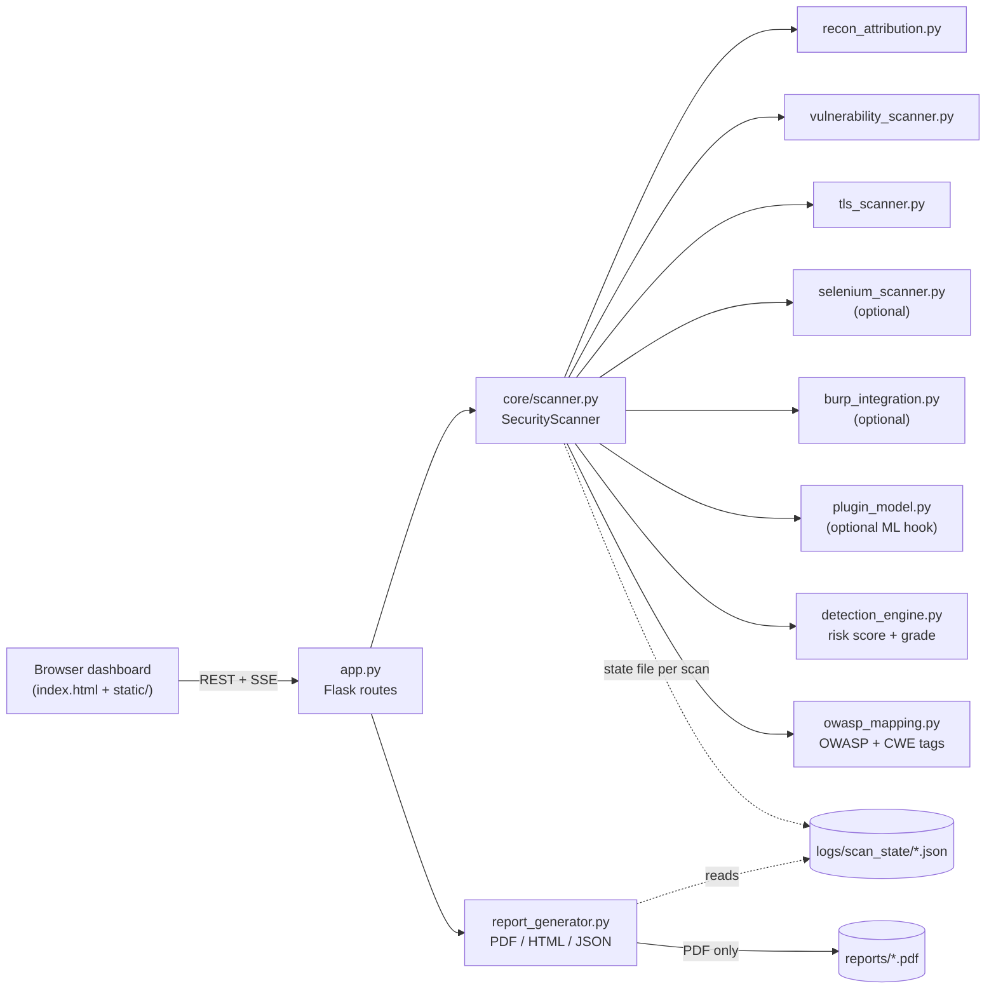
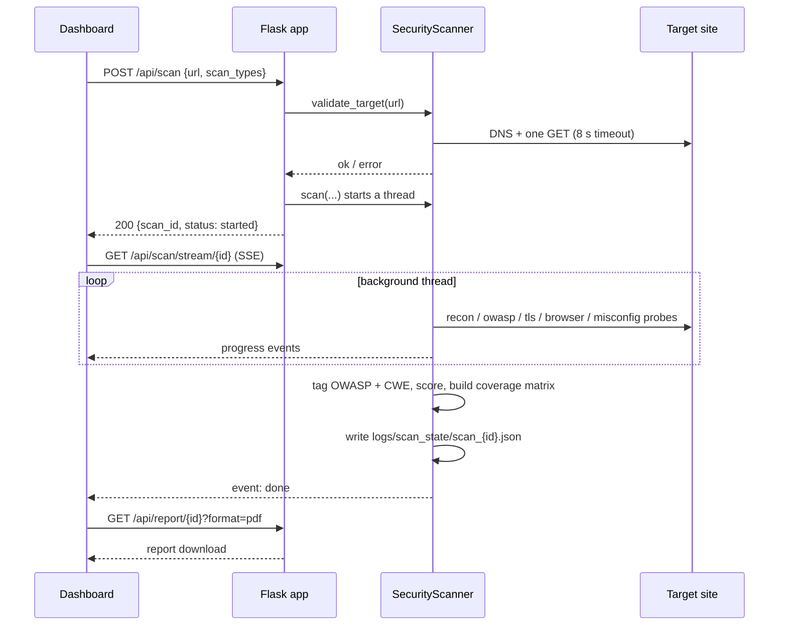

# Architecture

How Kavalu Security Engine is put together, and *why* it is shaped this way.
Read this before making structural changes.

- [System overview](#system-overview)
- [Scan lifecycle](#scan-lifecycle)
- [Modules](#modules)
- [Scoring](#scoring)
- [State, files and concurrency](#state-files-and-concurrency)
- [Design principles](#design-principles)

## System overview

One Flask process serves **both** the dashboard (`index.html` plus the files in `static/`) and the JSON/SSE API.
There is no database, no message queue and no front-end build step: the dashboard is plain HTML, CSS and JavaScript.



## Scan lifecycle

`POST /api/scan` validates the target, starts a **background thread**, and returns a `scan_id` immediately.
The browser then follows progress over Server-Sent Events (with a polling fallback).



Which modules run is decided by `scan_types` (see [API reference](api.md#start-a-scan)):

| Value | Runs |
|---|---|
| `recon` | Infrastructure/attribution discovery **and the 6 security-header checks** |
| `owasp` | Injection probes: XSS, SQLi, command injection, path traversal, open redirect, host-header, SSRF candidates, CSRF |
| `tls` | HTTPS presence, negotiated protocol, certificate validity |
| `browser` | Headless Chromium checks (also requires `use_selenium: true` and Selenium + Chromium installed) |
| `misconfig` | Sensitive paths, CORS, HTTP methods, cookie flags, debug output, outdated libraries, SRI |
| `burp` | Routes traffic via Burp (also requires `use_burp: true`) |
| `vulnerabilities` | Legacy alias: `owasp` **and** `misconfig` |
| `all` | Everything above |

## Modules

| File | Responsibility |
|---|---|
| `app.py` | Flask app: routes, CORS and security headers, SSE response. No scanning logic. |
| `index.html`, `static/` | The dashboard: one page, one stylesheet, one script. No libraries, no external files. |
| `core/scanner.py` | Orchestrator: target validation, thread management, status/progress, persistence, security-header checks, assembling the final result. |
| `core/vulnerability_scanner.py` | Active HTTP probes. Two entry points: `scan_owasp()` and `scan_misconfig()`. |
| `core/tls_scanner.py` | One TLS handshake; certificate expiry and negotiated protocol version. |
| `core/recon_attribution.py` | Hosting/IP/ASN/geolocation and public developer-attribution discovery. Calls a third-party IP lookup (see [SECURITY.md](../SECURITY.md#data-sent-to-third-parties)). |
| `core/selenium_scanner.py` | Headless Chromium: DOM XSS via location hash, mixed content, insecure forms, client storage. |
| `core/burp_integration.py` | Proxy routing to Burp at `127.0.0.1:8080` plus a connectivity check. |
| `core/plugin_model.py` | Optional hook that sends page scripts to a self-hosted ML service ([configuration](configuration.md#external-ml-model-plugin)). |
| `core/owasp_mapping.py` | The `TYPE_TO_OWASP` table (finding type → OWASP category + CWE) and the coverage matrix. |
| `core/detection_engine.py` | Deterministic risk score and letter grade. |
| `core/report_generator.py` | PDF (ReportLab), HTML and JSON reports from a saved scan state. |
| `core/paths.py` | The single source of truth for every directory the engine writes to. |

## Scoring

Fully deterministic; the same findings always give the same score.

```text
score = min(100, Σ  weight(severity) × 0.6^n )
```

`n` is how many findings of the **same severity** were already counted (0 for the first, 1 for the second, …).

| Severity | Weight | Highest total that severity can ever contribute |
|---|---:|---:|
| critical | 40 | 100 |
| high | 22 | 55 |
| medium | 10 | 25 |
| low | 4 | 10 |
| info | 0 | 0 |

However many findings there are, one severity can add only a limited total (the last column, which is `weight ÷ 0.4`). A score of 100 therefore needs a mix of severities.

| Score | Grade | Label |
|---:|:---:|---|
| 0 – < 20 | **A** | Low Risk |
| 20 – < 40 | **B** | Moderate Risk |
| 40 – < 60 | **C** | Elevated Risk |
| 60 – < 80 | **D** | High Risk |
| 80 – 100 | **F** | Critical Risk |

The code is in `core/detection_engine.py`; the tests in `tests/test_detection_engine.py` pin every boundary.

## State, files and concurrency

- **In memory:** running scans live in `SecurityScanner.active_scans`.
  A restart loses any scan that is still running.
- **On disk, per scan:** `logs/scan_state/scan_<id>.json`, written as the scan progresses.
  It lets a finished scan be re-read after a restart and rendered into a report.
- **Reports:** PDFs are written to `reports/` (named `scan_<first 8 of id>_<timestamp>.pdf`).
  HTML and JSON reports are built in memory and streamed, never written to disk.
- **No server-side history.** `GET /api/history` always returns `[]`; the dashboard keeps its history in the visitor's `localStorage`.
- **Where files go** is controlled by `KAVALU_DATA_DIR` ([configuration](configuration.md#environment-variables)).
  If `reports/` is not writable, PDFs fall back to a temp directory.
- **Run exactly one worker process.** State is per-process, so a second Gunicorn worker would answer
  "Scan not found" for scans started on the first. Scale with threads (`--threads 16`), not workers.
  Each open SSE stream holds one thread for the scan's duration.

## Design principles

1. **Explainable over clever.** Every finding comes from a readable rule, and every score from a published formula. There is no black-box model in the core path.
2. **Low-impact probes.** Checks are bounded, use short timeouts and avoid destructive payloads. They are still *active* (they submit payloads and forms), which is why they must only be run against systems you are authorised to test.
3. **Everything is a finding dict.** Modules return lists of plain dicts; the orchestrator tags, scores and reports them uniformly. A new check needs no new plumbing ([extending guide](extending.md)).
4. **Degrade, don't crash.** A module that cannot run (no Chromium, unreachable proxy, network error) reports an informational finding and the rest of the scan continues.
5. **Privacy by default.** No global scan history; no accounts; no analytics.
